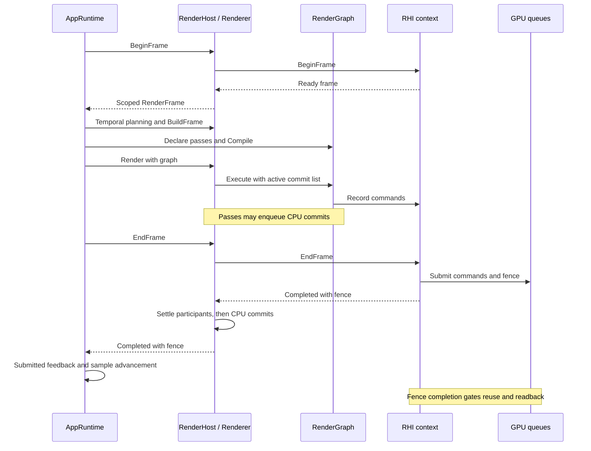
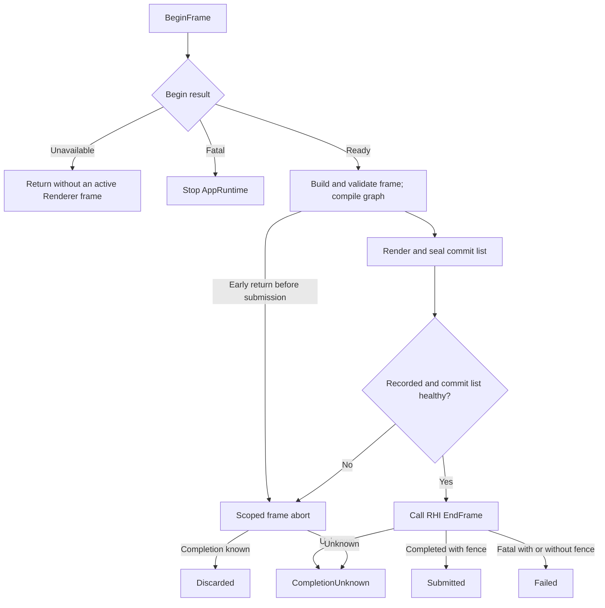

# Frame Execution and Settlement
Atlas ID: atlas.runtime.frame-execution

- Question: what happens to recorded GPU work and dependent CPU state when a frame
  does not complete successfully?
- VerifiedAgainst: `62772447328f54aa8d2814f3489a939173ec2a27`
- Refresh triggers: begin/end outcomes, early-return cleanup, participant order,
  submission feedback, borrowing or GPU-dependent retirement changes.

This map follows the shared AppRuntime frame path and Runtime settlement on DX12 and
Vulkan; the [overview](README.md) gives the project layers.

## One successful frame

Arrows are synchronous calls and returns on the application owner thread, except
the queue submission and the fence note. GPU work outlives command recording and
may finish after EndFrame returns.



## Early exit and outcome derivation

Arrows below are **control flow**. The RHI result and the Renderer end/abort path
together determine the settlement.



After BeginFrame returns Ready, an early return from `TickFrame` destroys the
move-only `RenderFrame`, which aborts the frame through the RenderHost. A frame that
Renderer did not record, for example because its upload-order wait failed, is
aborted inside EndFrame instead.

| Settlement | Meaning and retention |
| --- | --- |
| `Submitted` | EndFrame completed the frame transaction. Its fence orders the frame's work; it does not mean the GPU has finished |
| `Failed` | EndFrame returned Fatal. Work may have executed fully, partly or not at all, so capture fails and temporal history is invalidated. A valid fence still retains resources; an absent fence means no work is outstanding, not that nothing ran |
| `Discarded` | Renderer took its abort path and the recorded commands never execute. Capture requests that did not name this frame are requeued. Graph resources retire on the abort fence, or on the last submitted fence when the abort submitted nothing |
| `CompletionUnknown` | Neither path could verify completion. Renderer is poisoned, no further frame begins, and GPU-visible owners stay retained without ordinary graph retirement |

Three backend details affect these outcomes:

- A submission can succeed and presentation still fail. DX12 can fail Present;
  Vulkan can fail presentation or closing the frame's descriptor arena. These
  frames are Failed with a real fence.
- A backend can also abort inside its own EndFrame after a recording or
  upload-publication failure. The result still comes back through EndFrame, so the
  frame settles as Failed although its commands never ran: the outcome follows the
  Renderer path, not GPU execution.
- Abort does not execute the recorded commands, but the native abort can still
  submit work, for example to signal retirement or release an acquired swapchain
  image. Vulkan's abort may need a fence or a checked idle wait, so an abort can
  also end in CompletionUnknown.

AppRuntime decides separately whether to keep running:

| `TickFrame` path | Settlement | AppRuntime |
| --- | --- | --- |
| Early return after sequence rejection, skipped validation or resource-export deferral | Discarded | Continues with the next tick |
| Early return after validation or graph compilation failure | Discarded | Stops |
| EndFrame returns Completed | Submitted | Sends submitted feedback |
| EndFrame returns Fatal | Failed, CompletionUnknown, Discarded (unrecorded frame) or Submitted ([late enqueue](#settlement-contract-failures)) | Stops without feedback |

When refreshing this map, recheck three easily missed paths first: the late-enqueue
exception, both native abort paths and unverified teardown.

```text
Anchors:
  - Sources/GGLabAppRuntime/GGLabAppRuntimeFrame.cpp::TickFrame
  - Sources/GGLabRuntime/Private/Graphics/Renderer.cpp::Renderer::SettleFrame
  - Sources/GGLabRuntime/Private/Graphics/RenderFrameOutcome.h::ResolveRenderFrameOutcome
ReviewPaths:
  - Sources/GGLabRuntime/Private/Graphics/RHI/DX12/DX12Context.cpp
  - Sources/GGLabRuntime/Private/Graphics/RHI/Vulkan/VulkanContext.cpp
  - Sources/GGLabAppRuntime/GGLabAppRuntimeServices.cpp
```

## Contracts
Atlas ID: atlas.runtime.frame-contracts

The three rules below cover cross-participant coordination that no single
interface owns. They detail the GPU and lifetime rules in
[AGENTS.md](../../AGENTS.md#gpu-shader-and-lab-invariants); keep both consistent
when either changes. Per-interface rules stay in
[RGDeferredCommit.h](../../Sources/GGLabRuntime/Public/GGLabRuntime/Graphics/RenderGraph/RGDeferredCommit.h),
[RHIContext.h](../../Sources/GGLabRuntime/Public/GGLabRuntime/Graphics/RHI/RHIContext.h),
[RHIDevice.h](../../Sources/GGLabRuntime/Public/GGLabRuntime/Graphics/RHI/RHIDevice.h)
and [RHIFence.h](../../Sources/GGLabRuntime/Public/GGLabRuntime/Graphics/RHI/RHIFence.h).

### Frame settlement

Each frame derives one private outcome from the Renderer path and the RHI result
(`ResolveRenderFrameOutcome`) and settles its Runtime participants once, in
`Renderer::SettleFrame`, in these orders:

| Outcome | Required Runtime participant order |
| --- | --- |
| Submitted / Failed | Runtime capture → live/bake atmosphere → temporal transaction/history → last submitted fence and IBL scheduler → graph retirement |
| Discarded | Live/bake atmosphere → IBL scheduler → last submitted fence → temporal transaction → graph retirement → Runtime capture |
| CompletionUnknown | Poison → fail/retain Runtime capture → retain live/bake atmosphere → abort IBL scheduling → abort/invalidate temporal state; no ordinary graph retirement |

These are the implementation's baseline orders, also stated in comments inside
`Renderer::SettleFrame`; change the table and those comments together. One
placement has a recorded reason: on the abort path, capture releases its
unsubmitted taps last, after the RHI abort has recorded the frame's resource uses.
The two orders have not been shown to be interchangeable, so moving a participant
or unifying them needs a review of its ownership and fence dependencies.

Plain CPU deferred commits run only for Submitted: once each, in enqueue order,
after every participant. Every other outcome discards them, and so does
frame-lifetime cleanup. This keeps recorded work from publishing CPU state before
its submission is accepted, while GPU-dependent owners are still retained when the
transaction fails. Passes must not reproduce this policy.

### Settlement contract failures

Renderer seals the frame's commit list whenever `Render` exits. An enqueue that
arrives after that, for example through an enqueue capability kept past `Render`,
is rejected and marks the list failed. The outcome depends on when it arrives:

| Late enqueue arrives | Runtime participants | CPU commits | EndFrame returns |
| --- | --- | --- | --- |
| Before RHI submission | Abort path: Discarded, or CompletionUnknown | Discarded | The abort's result |
| After the RHI accepted the submission, before the commits start | Settled as Submitted | Discarded | Fatal with the real submitted fence |
| While the commits run | Settled as Submitted | The original batch runs once | Fatal with the real submitted fence |

After an accepted submission nothing is rolled back or settled again. A failure
seen before the commits start cancels them; once they start, the original batch
completes rather than publishing only part of it. In both post-submission rows the
layers disagree: Runtime participants settled as Submitted, yet EndFrame returns
Fatal, so AppRuntime stops without sending submitted feedback. An enqueue after
EndFrame returns is outside this contract, because `RGExecuteContext` must not be
retained beyond execution.

### Teardown ownership

Shut down in this order:

1. Stop new producer work and drain or cancel the application work that depends on
   Runtime services.
2. Establish verified idle or natively confirmed device loss
   (`QuiesceRHIForTeardown`) before destroying GPU-visible owners, or tooling,
   content and assets that borrow GPU services.
3. Release those consumers while the Runtime services they borrow are still alive.
4. Finalize and release the RenderHost.

Unknown completion and timed-out waits do not count as device loss. When teardown
ends in `RHITeardownState::Unverified` on a live device, GPU-visible memory is
leaked rather than destroyed: AppRuntime shutdown exits the process without
destructing it, and `Renderer::Finalize` abandons its retained owners. After
confirmed loss, owners may be destroyed without fence waits, but GPU-written
contents stay unusable.

```text
Anchors:
  - Sources/GGLabRuntime/Private/Graphics/Renderer.cpp::Renderer::SettleFrame
  - Sources/GGLabRuntime/Private/Graphics/Renderer.cpp::Renderer::EndFrame
  - Sources/GGLabAppRuntime/GGLabAppRuntimeFrame.cpp::TickFrame
  - Sources/GGLabAppRuntime/GGLabAppRuntimeServices.cpp::Shutdown
ReviewPaths:
  - Sources/GGLabRuntime/Private/Graphics/RenderGraph/RGDeferredCommit.cpp
  - Sources/GGLabRuntime/Private/Graphics/RHI/RHIContext.cpp
  - Tests/GGLabAppRuntime/GpuFaultLifecycleSelfTests.cpp
```

## Module cards

Cards share this map's `VerifiedAgainst` baseline.

### Application orchestration
Atlas ID: atlas.application.frame-orchestration

- **Source owner:** `GGLabAppRuntime`, under `Sources/GGLabAppRuntime`.
- **Responsibility:** begin, build, validate, execute and end each frame, then send
  host-level feedback. WinApp calls in through `GGLabAppRuntime::Tick`.
- **Public interface:** [GGLabAppRuntime.h](../../Sources/GGLabAppRuntime/GGLabAppRuntime.h).
- **Implementation:** [TickFrame](../../Sources/GGLabAppRuntime/GGLabAppRuntimeFrame.cpp)
  and [InitializeServices / Shutdown](../../Sources/GGLabAppRuntime/GGLabAppRuntimeServices.cpp).
- **Lifetime:** owns the RenderHost and shared services; the RenderGraph lives for one
  `TickFrame`. Composition and service pointers, and the ready frame's abort
  cleanup, borrow the host.
- **Boundary:** [success feedback](#settlement-contract-failures) waits for Runtime
  settlement; [teardown](#teardown-ownership) releases consumers while their
  borrowed services are alive.
- **Verification:** `GGLabAppRuntimeTests` suite `gpu-fault-lifecycle`, including
  late-enqueue feedback suppression and safe shutdown. The test project declares a
  Private RHI include path for its fault harness.

```text
Anchors:
  - Sources/GGLabAppRuntime/GGLabAppRuntimeFrame.cpp::TickFrame
  - Sources/GGLabAppRuntime/GGLabAppRuntimeServices.cpp::Shutdown
ReviewPaths:
  - Sources/WinApp/Application/Application.cpp
  - Projects/GGLabAppRuntime/GGLabAppRuntime.vcxproj
```

### Render host and settlement
Atlas ID: atlas.runtime.render-host

- **Source owner:** `GGLabRuntime`; Public RenderHost interface, Private Renderer.
- **Responsibility:** the active frame, Runtime participants, the commit list and
  GPU services.
- **Public interface:** [RenderHost.h](../../Sources/GGLabRuntime/Public/GGLabRuntime/Graphics/RenderHost.h),
  including `CreateRenderHost` and the move-only `RenderFrame` abort handle.
- **Implementation:** [Renderer](../../Sources/GGLabRuntime/Private/Graphics/Renderer.cpp)
  and [outcome derivation](../../Sources/GGLabRuntime/Private/Graphics/RenderFrameOutcome.h).
- **Lifetime:** AppRuntime owns the host. Renderer owns the RHI context and pools,
  borrows the active graph and clears its active-frame state after settlement.
- **Boundary:** [frame settlement](#frame-settlement) keeps the four outcomes and
  their retention fences apart.
- **Verification:** the production Renderer in `GpuFaultLifecycleSelfTests.cpp`;
  outcome and commit-list contracts in `RenderingContractSelfTests.cpp`.

```text
Anchors:
  - Sources/GGLabRuntime/Private/Graphics/Renderer.cpp::Renderer::EndFrame
  - Sources/GGLabRuntime/Public/GGLabRuntime/Graphics/RenderHost.h::RenderFrame::Reset
ReviewPaths:
  - Sources/GGLabRuntime/Private/Graphics/RenderHostFactory.cpp
  - Sources/GGLabRuntime/Private/Graphics/RenderFrameOutcome.h
```

### RenderGraph execution and deferred CPU commits
Atlas ID: atlas.runtime.graph-execution

- **Source owner:** `GGLabRuntime`, RenderGraph subtree.
- **Responsibility:** compile declared dependencies and execute the surviving passes.
  Released graph handles go to frame retirement, not immediate physical reuse.
- **Public interface:** [RenderGraph.h](../../Sources/GGLabRuntime/Public/GGLabRuntime/Graphics/RenderGraph/RenderGraph.h)
  and [RGDeferredCommit.h](../../Sources/GGLabRuntime/Public/GGLabRuntime/Graphics/RenderGraph/RGDeferredCommit.h).
- **Implementation:** [RenderGraph](../../Sources/GGLabRuntime/Private/Graphics/RenderGraph/RenderGraph.cpp),
  [RGExecutor](../../Sources/GGLabRuntime/Private/Graphics/RenderGraph/RGExecutor.cpp)
  and the [commit list](../../Sources/GGLabRuntime/Private/Graphics/RenderGraph/RGDeferredCommit.cpp).
- **Lifetime:** execution borrows the command contexts, the transient pool and the
  caller-owned commit list. Culled passes enqueue nothing. Renderer settles the list
  it supplies for the active frame.
- **Boundary:** graph ownership rules are in
  [AGENTS.md](../../AGENTS.md#gpu-shader-and-lab-invariants);
  [frame settlement](#frame-settlement) decides when CPU state may publish.
- **Verification:** `GGLabRuntimeTests` suite `rendering-contracts`, plus the
  production fault harness.

```text
Anchors:
  - Sources/GGLabRuntime/Private/Graphics/RenderGraph/RenderGraph.cpp::RenderGraph::Retire
  - Sources/GGLabRuntime/Private/Graphics/RenderGraph/RGDeferredCommit.cpp::RGDeferredCommitList::CommitAll
ReviewPaths:
  - Sources/GGLabRuntime/Private/Graphics/RenderGraph/RGExecutor.cpp
  - Sources/GGLabRuntime/Public/GGLabRuntime/Graphics/RenderGraph/RGDeferredCommit.h
```

### RHI submission and resource retirement
Atlas ID: atlas.runtime.rhi-submission

- **Source owner:** `GGLabRuntime`; neutral RHI plus Private DX12 and Vulkan
  backends. Vulkan sources compile only when `GGLAB_ENABLE_VULKAN != 0`.
- **Responsibility:** native submit, present and abort; upload retention; checked
  completion.
- **Public interface:** [RHIContext.h](../../Sources/GGLabRuntime/Public/GGLabRuntime/Graphics/RHI/RHIContext.h),
  [RHIDevice.h](../../Sources/GGLabRuntime/Public/GGLabRuntime/Graphics/RHI/RHIDevice.h)
  and [RHIFence.h](../../Sources/GGLabRuntime/Public/GGLabRuntime/Graphics/RHI/RHIFence.h).
- **Implementation:** [submission resolution](../../Sources/GGLabRuntime/Private/Graphics/RHI/RHIFrameSubmission.cpp),
  [DX12](../../Sources/GGLabRuntime/Private/Graphics/RHI/DX12/DX12Context.cpp),
  [Vulkan](../../Sources/GGLabRuntime/Private/Graphics/RHI/Vulkan/VulkanContext.cpp)
  and the [transient pool](../../Sources/GGLabRuntime/Private/Graphics/Resource/TransientResourcePool.cpp).
- **Lifetime:** Renderer owns the context and pool. Backend frame and upload owners
  keep accepted work until its completion permits release.
- **Boundary:** [teardown ownership](#teardown-ownership) coordinates consumers;
  native fence and device-loss policy stay in the backends.
- **Verification:** Runtime submission contracts and AppRuntime's simulated fault
  harness.

```text
Anchors:
  - Sources/GGLabRuntime/Private/Graphics/RHI/RHIFrameSubmission.cpp::ResolveFrameSubmission
  - Sources/GGLabRuntime/Private/Graphics/RHI/RHIContext.cpp::QuiesceRHIForTeardown
ReviewPaths:
  - Sources/GGLabRuntime/Private/Graphics/RHI/DX12/DX12Context.cpp
  - Sources/GGLabRuntime/Private/Graphics/RHI/Vulkan/VulkanContext.cpp
  - Sources/GGLabRuntime/Private/Graphics/Resource/TransientResourcePool.cpp
```
