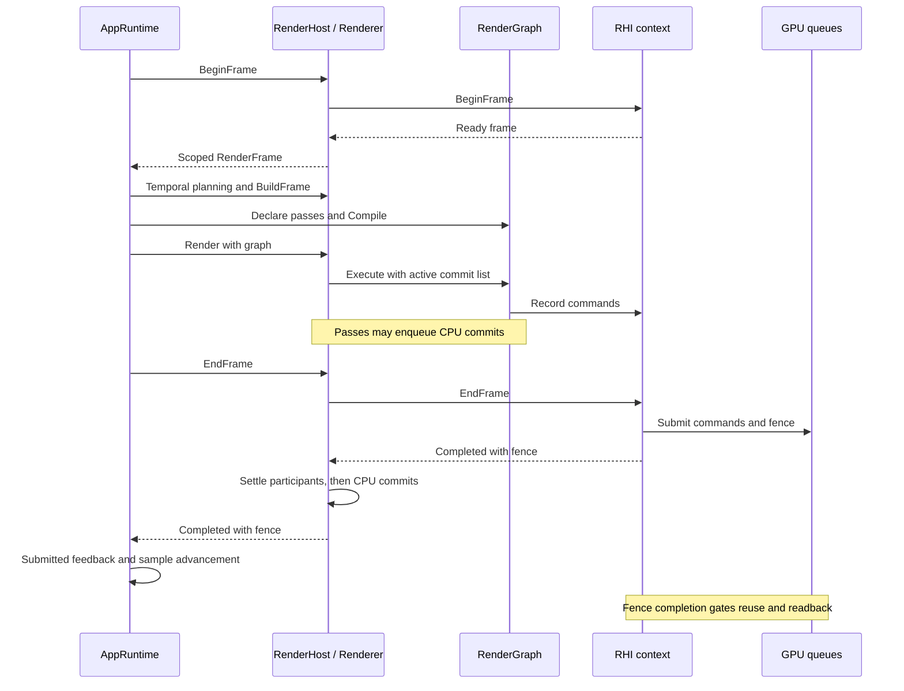
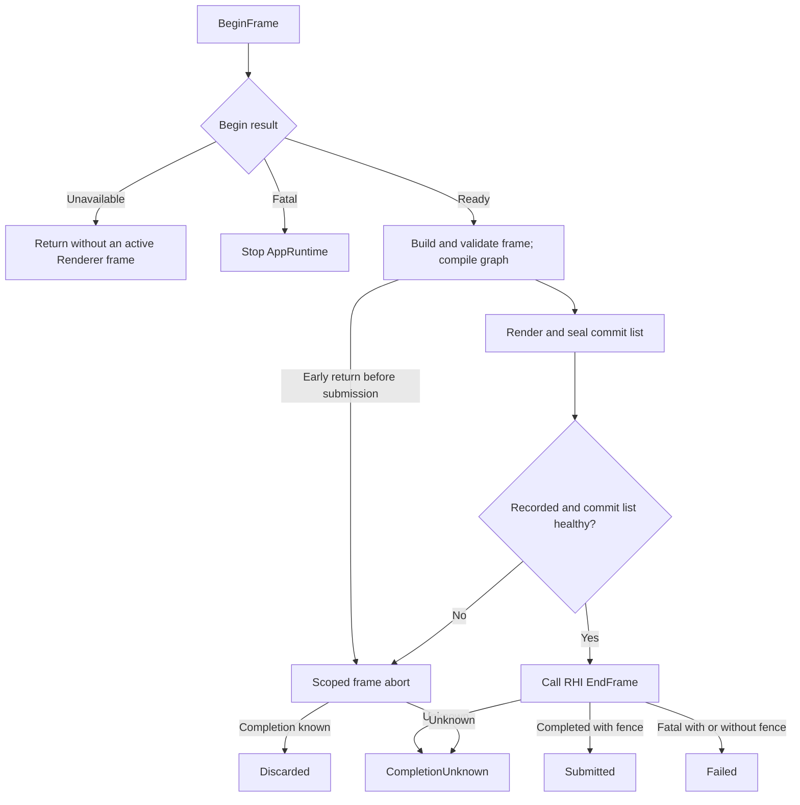
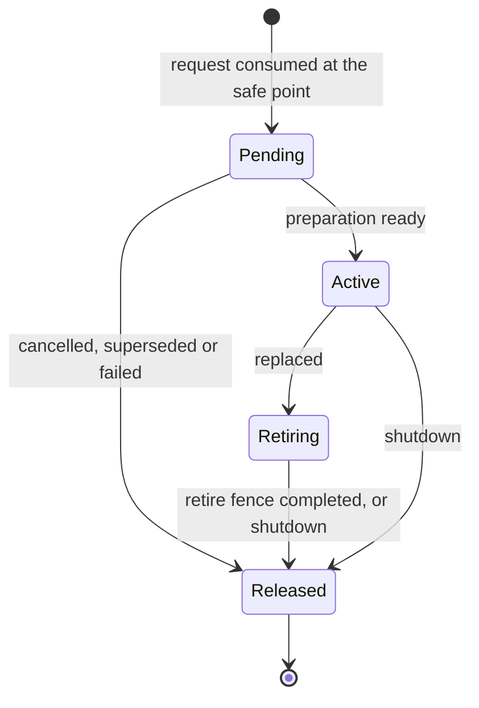

# Frame Execution and Settlement
Atlas ID: atlas.runtime.frame-execution

- VerifiedAgainst: `fbb5f36a71fbeacb1350ad68458f04e6c3a3b8cd`

AppRuntime builds frames and coordinates content; Runtime records, submits and
settles them on DX12 or Vulkan. The [overview](README.md) shows project layers;
the [module catalog](Module_Catalog.md) links interfaces and implementations.

## One successful frame

Arrows are synchronous calls and returns on the application owner thread, except
the queue submission and the fence note. GPU work outlives command recording and
may finish after EndFrame returns.



## Early exit and outcome derivation

Arrows below are **control flow**. The RHI result and the Renderer end/abort path
together determine the settlement.



After BeginFrame returns Ready, an early return from `TickFrame` destroys the
move-only `RenderFrame`, which aborts the frame through the RenderHost. A frame that
Renderer did not record, for example because its upload-order wait failed, is
aborted inside EndFrame instead.

| Settlement | Meaning and retention |
| --- | --- |
| `Submitted` | EndFrame completed the frame transaction. Its fence orders the frame's work; it does not mean the GPU has finished |
| `Failed` | EndFrame returned Fatal. Work may have executed fully, partly or not at all. Capture fails and temporal history is invalidated. A returned fence retains resources; an absent fence certifies no outstanding work |
| `Discarded` | Renderer took its abort path and the recorded commands never execute. Capture requests that did not name this frame are requeued. Graph resources retire on the abort fence, or on the last submitted fence when the abort submitted nothing |
| `CompletionUnknown` | Neither path could verify completion. Renderer is poisoned, no further frame begins, and GPU-visible owners stay retained without ordinary graph retirement |

Presentation or descriptor-arena closure can fail after submission, producing
Failed with a real fence. An EndFrame Fatal result remains Failed even when the
backend aborted its commands.
Native abort may submit retirement or swapchain-release work, so its completion
can require a fence or checked idle wait and can remain unknown.

AppRuntime decides separately whether to keep running:

| `TickFrame` path | Settlement | AppRuntime |
| --- | --- | --- |
| Early return after sequence rejection, skipped validation or resource-export deferral | Discarded | Continues with the next tick |
| Early return after validation or graph compilation failure | Discarded | Stops |
| EndFrame returns Completed | Submitted | Sends submitted feedback |
| EndFrame returns Fatal | Failed, CompletionUnknown, Discarded (unrecorded frame) or Submitted ([late enqueue](#settlement-contract-failures)) | Stops without feedback |

```text
Anchors:
  - Sources/GGLabAppRuntime/GGLabAppRuntimeFrame.cpp::TickFrame
  - Sources/GGLabRuntime/Private/Graphics/Renderer.cpp::Renderer::SettleFrame
  - Sources/GGLabRuntime/Private/Graphics/RenderFrameOutcome.h::ResolveRenderFrameOutcome
ReviewPaths:
  - Sources/GGLabRuntime/Private/Graphics/RHI/DX12/DX12Context.cpp
  - Sources/GGLabRuntime/Private/Graphics/RHI/Vulkan/VulkanContext.cpp
  - Sources/GGLabAppRuntime/GGLabAppRuntimeServices.cpp
```

## Content transitions
Atlas ID: atlas.application.content-transitions

- VerifiedAgainst: `fbb5f36a71fbeacb1350ad68458f04e6c3a3b8cd`

`DemoManager` switches Demos; `LabRuntime` inside the Lab host Demo switches Lab
sessions. Both use the following states and the
[content retirement](#content-retirement) rule.



| Step | Demos | Lab sessions |
| --- | --- | --- |
| Request | `DemoManager::RequestActiveDemo` | `ILabControl`, queued in `LabCommandQueue` |
| Safe point | `BeginTransitionTick` and `CompleteTransitionTick` in `TickFrame`, before the Demo's `Update` | `LabRuntime::ProcessPendingCommands`, called from `DemoLabHost::Update` before `BeginFrame` |
| Activation | Parameter and sequence bindings are released, then the old Demo exits and retires | The old session exits and retires; the temporal session serial advances |
| Release | `PollRetiringDemos` | `PollRetiringSessions` |

The active content keeps rendering while its replacement prepares. A retiring entry
holds the fence of the last frame that sent feedback, and only frames whose EndFrame
returned Completed send it. `DemoManager::GetActiveContentIdentity` combines the two
serials; AppRuntime rebinds parameter control and frame sequences to it.

Inside a Lab session:

| Change | How it applies |
| --- | --- |
| Switch | A new pending session of the target Lab |
| Restart or run configuration | A new pending session of the same Lab, restoring the current parameter values |
| Parameter with `RebuildScene`, `RecreatePipeline` or `RestartSession` impact | A new pending session; never in place |
| `Immediate` parameter | In place, through `ApplyImmediateParameters` and the session's `ViewRenderProfile` |

A Lab tunes Runtime passes through its per-view `ViewRenderProfile`.
[SessionParameterControl](../../Sources/GGLabAppRuntime/Parameters/SessionParameterControl.h)
coordinates parameter batches and receipts. Napa's session-owned mesh sets record
their last-use fence in `OnFrameSubmitted` and retire through completion polling;
preparation uploads belong to the asset upload scheduler.

```text
Anchors:
  - Sources/GGLabAppRuntime/Demo/DemoManager.cpp::DemoManager::CommitPendingDemo
  - Sources/GGLabAppRuntime/Lab/LabRuntime.cpp::LabRuntime::ProcessPendingCommands
  - Sources/GGLabAppRuntime/Lab/LabRuntime.cpp::LabRuntime::CommitPendingSession
  - Sources/WinAppHost/Application/Demo/DemoLabHost.cpp::DemoLabHost::Update
ReviewPaths:
  - Sources/GGLabAppRuntime/Lab/LabRuntimeParameters.cpp
  - Sources/GGLabAppRuntime/GGLabAppRuntimeFrame.cpp
  - Sources/WinAppHost/Application/Lab/Sessions/NapaVoxelLabSession.cpp
```

## Contracts
Atlas ID: atlas.runtime.frame-contracts

These cross-participant rules accompany
[AGENTS.md](../../AGENTS.md#gpu-shader-and-lab-invariants). Interface contracts are in
[RGDeferredCommit.h](../../Sources/GGLabRuntime/Public/GGLabRuntime/Graphics/RenderGraph/RGDeferredCommit.h),
[RHIContext.h](../../Sources/GGLabRuntime/Public/GGLabRuntime/Graphics/RHI/RHIContext.h),
[RHIDevice.h](../../Sources/GGLabRuntime/Public/GGLabRuntime/Graphics/RHI/RHIDevice.h)
and [RHIFence.h](../../Sources/GGLabRuntime/Public/GGLabRuntime/Graphics/RHI/RHIFence.h).

### Frame settlement

Each frame derives one private outcome from the Renderer path and the RHI result
(`ResolveRenderFrameOutcome`) and settles its Runtime participants once, in
`Renderer::SettleFrame`, in these orders:

| Outcome | Required Runtime participant order |
| --- | --- |
| Submitted / Failed | GI reference observation → Runtime capture → live/bake atmosphere → temporal transaction/history → last submitted fence and IBL scheduler → graph retirement |
| Discarded | GI reference observation → live/bake atmosphere → IBL scheduler → last submitted fence → temporal transaction → graph retirement → Runtime capture |
| CompletionUnknown | Retain GI reference observation → poison → fail/retain Runtime capture → retain live/bake atmosphere → abort IBL scheduling → abort/invalidate temporal state; no ordinary graph retirement |

GI reference pending tile cursors advance only on Submitted. The first tile defines all pending
pixels; later tiles preserve them with declared ReadWrite access. Sums, compensation and RNG state
publish together only after the complete spatial sweep has submitted. GPU completion gates each
subsequent tile and capture readiness; partial sweeps resolve the previous complete sample count.
Cancellation retires resources through the last-use fence; unknown completion retains them
through checked teardown. Observation scene identity uses a weak control-block key;
query/build submission leases retain the immutable snapshot and its reduced-material texture
interests. Observations do not extend content asset ownership into AssetManager shutdown.

On the abort path, capture releases unsubmitted taps after the RHI abort has
recorded the frame's resource uses.

Plain CPU deferred commits run only for Submitted: once each, in enqueue order,
after every participant. Every other outcome discards them, and so does
frame-lifetime cleanup. Renderer owns this publication boundary; GPU-dependent
owners follow the outcome's retention rules.

### Settlement contract failures

Renderer seals the frame's commit list whenever `Render` exits. An enqueue that
arrives after that, for example through an enqueue capability kept past `Render`,
is rejected and marks the list failed. The outcome depends on when it arrives:

| Late enqueue arrives | Runtime participants | CPU commits | EndFrame returns |
| --- | --- | --- | --- |
| Before RHI submission | Abort path: Discarded, or CompletionUnknown | Discarded | The abort's result |
| After the RHI accepted the submission, before the commits start | Settled as Submitted | Discarded | Fatal with the real submitted fence |
| While the commits run | Settled as Submitted | The original batch runs once | Fatal with the real submitted fence |

After accepted submission, Runtime participants keep their Submitted settlement.
A failure before CPU commits start cancels the batch; once started, the original
batch finishes once. EndFrame returns Fatal and AppRuntime stops without submitted
feedback. `RGExecuteContext` is execution-scoped.

### Teardown ownership

Shut down in this order:

1. Revoke published service views before shutdown callbacks. Stop new producer work
   and drain or cancel application work that depends on Runtime services.
2. Establish verified idle or natively confirmed device loss
   (`QuiesceRHIForTeardown`) before destroying GPU-visible owners, or tooling,
   content and assets that borrow GPU services.
3. Release those consumers while the Runtime services they borrow are still alive.
4. Clear contained service bindings, then Finalize and release the RenderHost.

Unknown completion and timed-out waits do not count as device loss. When teardown
ends in `RHITeardownState::Unverified` on a live device, GPU-visible memory is
leaked rather than destroyed: AppRuntime shutdown exits the process without
destructing it, and `Renderer::Finalize` abandons its retained owners. After
confirmed loss, owners may be destroyed without fence waits, but GPU-written
contents stay unusable.

```text
Anchors:
  - Sources/GGLabRuntime/Private/Graphics/Renderer.cpp::Renderer::SettleFrame
  - Sources/GGLabRuntime/Private/Graphics/Renderer.cpp::Renderer::EndFrame
  - Sources/GGLabAppRuntime/GGLabAppRuntimeFrame.cpp::TickFrame
  - Sources/GGLabAppRuntime/GGLabAppRuntimeServices.cpp::Shutdown
ReviewPaths:
  - Sources/GGLabRuntime/Private/Graphics/RenderGraph/RGDeferredCommit.cpp
  - Sources/GGLabRuntime/Private/Graphics/RHI/RHIContext.cpp
  - Tests/GGLabAppRuntime/GpuFaultLifecycleSelfTests.cpp
```

### Content retirement
Atlas ID: atlas.application.content-retirement

- VerifiedAgainst: `fbb5f36a71fbeacb1350ad68458f04e6c3a3b8cd`

Content is a Demo or a Lab session together with what it owns: its World, cameras,
pipeline, asset interests and fence-dependent work.

- Replaced content stays alive until the GPU has finished the last frame that drew
  it and whose EndFrame returned Completed. Content that no such frame drew may be
  released at the next poll.
- Pending content is released as soon as its preparation is cancelled, superseded or
  fails. GPU work it starts belongs to a service that retains it until completion,
  such as the asset upload scheduler.
- Active content advances last-use frame fences only from submitted-frame feedback.
  Completion polling, including from `Update`, may release resources after their
  recorded fences complete.
- After a Failed or CompletionUnknown frame, AppRuntime stops ticking, and content is
  released only after [Teardown ownership](#teardown-ownership) establishes
  quiescence.

```text
Anchors:
  - Sources/GGLabAppRuntime/Lab/LabRuntime.cpp::LabRuntime::PollRetiringSessions
  - Sources/GGLabAppRuntime/Demo/DemoManager.cpp::DemoManager::PollRetiringDemos
  - Sources/GGLabAppRuntime/Lab/LabSessionBase.h::BeginPrepare
ReviewPaths:
  - Sources/GGLabAppRuntime/Demo/DemoBase.h
  - Sources/WinAppHost/Application/Lab/Sessions/NapaVoxelLabSession.cpp
  - Sources/WinAppHost/Application/Lab/NapaVoxel/NapaVoxelRenderState.cpp
  - Tests/GGLabAppRuntime/GpuFaultLifecycleSelfTests.cpp
```
