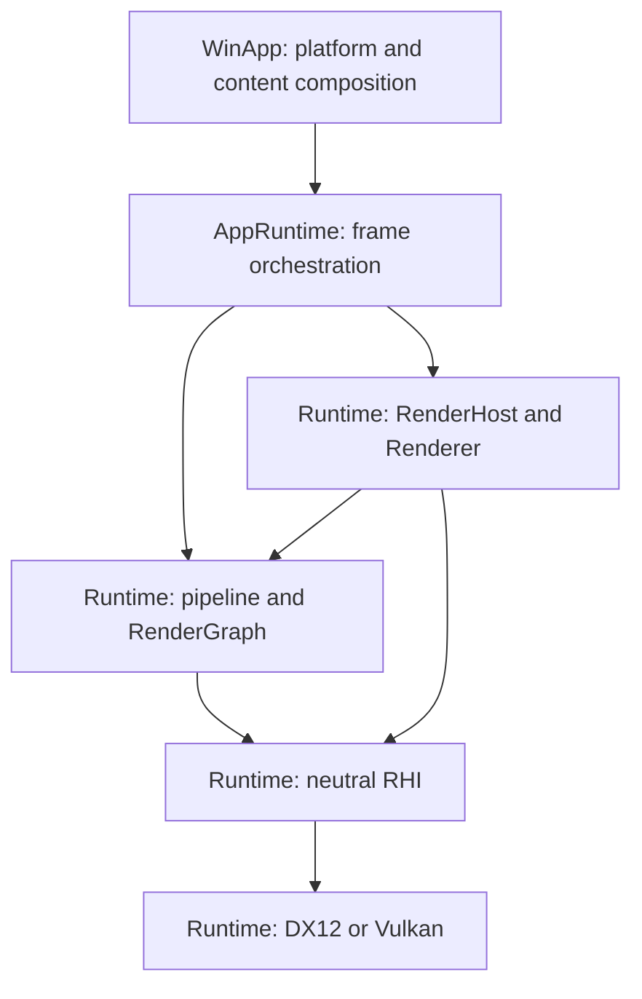

# GGLab Architecture Atlas
Atlas ID: atlas.overview.layers

- Question: where does a frame belong, and where should a change start?
- VerifiedAgainst: `77ed8765f1959978482ee8ede35f421d75ca3853`
- Refresh triggers: project ownership, service composition, public interfaces, or
  frame execution and teardown responsibilities change.

This page gives the layers and a short tour of one frame. The
[frame execution map](Frame_Execution_Map.md) then follows the success and failure
paths and content transitions in detail, the
[runtime boundaries map](Runtime_Boundaries_Map.md) shows where
render passes belong and how they are composed, and the
[boundary and drift guide](Boundary_And_Drift_Guide.md) explains how these pages are
kept current. The [module catalog](Module_Catalog.md) lists every card.
For a specific investigation or change, start with the
[task-routing table](../../.agents/skills/gglab-architecture/references/task-routing.md).

## Layers

Arrows mean **calls or supplies work to**.



## A short tour from startup to one frame

1. [WinApp Application](../../Sources/WinApp/Application/Application.cpp) creates
   the shared application and provides host inputs and the selected RHI factory.
   Before composing services it prepares development shader artifacts, or reads
   the packaged active registry in an artifact-only build.
2. [AppRuntime services](../../Sources/GGLabAppRuntime/GGLabAppRuntimeServices.cpp)
   create the Runtime RenderHost and shared services, register content and queue
   the startup Demo for [preparation](Frame_Execution_Map.md#content-transitions).
   AppRuntime owns the host. Contained composition borrows end before host Finalize;
   retained service views are revoked when the session closes.
3. [TickFrame](../../Sources/GGLabAppRuntime/GGLabAppRuntimeFrame.cpp) updates
   content, begins a frame, resolves immutable frame inputs and validates the
   pipeline. If it returns early after the frame began, the scoped `RenderFrame`
   handle aborts that frame.
4. The pipeline [declares graph passes](Runtime_Boundaries_Map.md#composition);
   RenderGraph compiles their dependencies and records the surviving passes through
   RHI contexts. A pass may also queue a CPU-side commit; the
   [Frame settlement](Frame_Execution_Map.md#frame-settlement) contract decides when
   it runs.
5. Renderer ends or aborts the frame and settles its Runtime participants once. The
   [settlement contract](Frame_Execution_Map.md#frame-settlement) keeps four
   outcomes apart: submitted, failed, discarded and completion unknown.
6. AppRuntime sends success feedback only when EndFrame returns Completed. The GPU
   may finish the frame later; resource reuse and readback wait for the frame's
   fence, not for EndFrame.

## Projects

The [repository map](Repository_Module_Map.md) lists all sixteen first-party
projects, their source owners, declared references and include visibility.

## Coverage and related guidance

These pages cover project ownership and declared build dependencies, the frame
path (execution, settlement, GPU-dependent retirement and teardown), render pass
composition and Lab lifetime.

When making a change, follow [AGENTS.md](../../AGENTS.md), the `Contracts` sections
of the maps and the owning tests linked from each module card. GPU capture and visual verification use the
[frame-capture skill](../../.agents/skills/gglab-frame-capture/SKILL.md).

```text
Anchors:
  - Projects/WinApp/WinApp.vcxproj
  - Projects/GGLabAppRuntime/GGLabAppRuntime.vcxproj
  - Projects/GGLabRuntime/GGLabRuntime.vcxproj
  - Sources/WinApp/Application/Application.cpp::Initialize
  - Sources/GGLabAppRuntime/GGLabAppRuntimeServices.cpp::InitializeServices
ReviewPaths:
  - GraphicsGadgetLab.sln
  - PropertySheets/*.props
  - Projects/*/*.vcxproj
```
