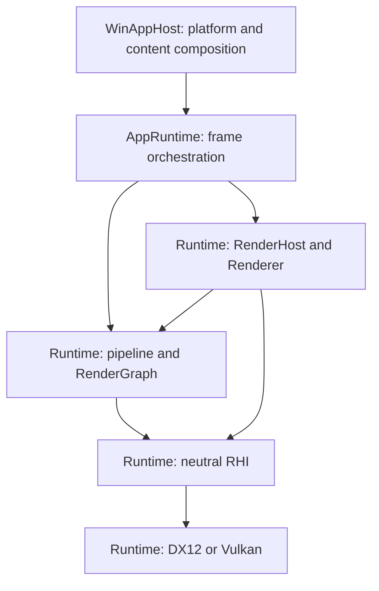

# GGLab Architecture Atlas
Atlas ID: atlas.overview.layers

- VerifiedAgainst: `c3a6b6b2575522cef469a7e20b0389722a9655f1`

| Map | Covers |
| --- | --- |
| [Repository ownership](Repository_Module_Map.md) | Projects, build dependencies and include visibility. |
| [Frame execution](Frame_Execution_Map.md) | Submission, settlement, content transitions and resource retirement. |
| [Render pass composition](Runtime_Boundaries_Map.md) | Pipeline seams, pass ownership and imported resources. |
| [Runtime control](Runtime_Control_Map.md) | Parameter ownership, display settings and frame evidence. |
| [Module catalog](Module_Catalog.md) | Public interfaces, implementations and owning tests. |

Use the [task-routing table](../../.agents/skills/gglab-architecture/references/task-routing.md)
for a specific change and the [maintenance guide](Boundary_And_Drift_Guide.md) when
updating a map. Commands and result handling belong to the
[verification guide](../../Tests/Verification/README.md).

## Layers

Arrows mean **calls or supplies work to**.



## A short tour from startup to one frame

1. [WinAppHost Application](../../Sources/WinAppHost/Application/Application.cpp)
   provides platform inputs, the selected RHI factory and shader artifacts.
2. [AppRuntime services](../../Sources/GGLabAppRuntime/GGLabAppRuntimeServices.cpp)
   own the RenderHost, compose shared services and prepare startup content.
3. [TickFrame](../../Sources/GGLabAppRuntime/GGLabAppRuntimeFrame.cpp) updates
   content, resolves frame inputs and validates the pipeline. The scoped
   `RenderFrame` handle aborts an unfinished frame.
4. The pipeline [declares graph passes](Runtime_Boundaries_Map.md#composition);
   RenderGraph compiles dependencies and records surviving passes through RHI.
5. Renderer ends or aborts the frame and settles its Runtime participants once. The
   [settlement contract](Frame_Execution_Map.md#frame-settlement) orders resource
   retirement and deferred CPU publication.
6. AppRuntime sends success feedback only when EndFrame returns Completed. The GPU
   may finish later; resource reuse and readback wait for its fence.

```text
Anchors:
  - Projects/WinApp/WinApp.vcxproj
  - Projects/GGLabAppRuntime/GGLabAppRuntime.vcxproj
  - Projects/GGLabRuntime/GGLabRuntime.vcxproj
  - Sources/WinAppHost/Application/Application.cpp::Initialize
  - Sources/GGLabAppRuntime/GGLabAppRuntimeServices.cpp::InitializeServices
ReviewPaths:
  - GraphicsGadgetLab.sln
  - PropertySheets/*.props
  - Projects/*/*.vcxproj
```
