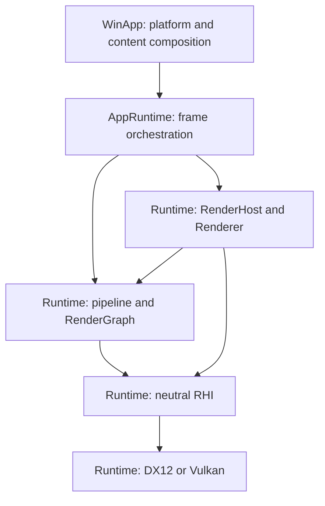

# GGLab Architecture Atlas
Atlas ID: atlas.overview.layers

- Question: where does a frame belong, and where should a change start?
- VerifiedAgainst: `ed1636bc06e0f2016c187575110017a9b21f6558`
- Refresh triggers: project ownership, service composition, public interfaces, or
  frame execution and teardown responsibilities change.

This page gives the layers and a short tour of one frame. The
[frame execution map](Frame_Execution_Map.md) then follows the success and failure
paths in detail, and the [boundary and drift guide](Boundary_And_Drift_Guide.md)
explains how these pages are kept current.

## Layers

Arrows mean **calls or supplies work to**; they are not project references or
instance ownership.



## A short tour from startup to one frame

1. [WinApp Application](../../Sources/WinApp/Application/Application.cpp) creates
   the shared application and provides host inputs and the selected RHI factory.
2. [AppRuntime services](../../Sources/GGLabAppRuntime/GGLabAppRuntimeServices.cpp)
   create the Runtime RenderHost and shared services. AppRuntime owns the host;
   composition and service pointers taken from it stay valid while the host lives.
3. [TickFrame](../../Sources/GGLabAppRuntime/GGLabAppRuntimeFrame.cpp) updates
   content, begins a frame, resolves immutable frame inputs and validates the
   pipeline. If it returns early after the frame began, the scoped `RenderFrame`
   handle aborts that frame.
4. The pipeline declares graph passes; RenderGraph compiles their dependencies and
   records the surviving passes through RHI contexts. A pass may queue a CPU-side
   commit, but the commit runs only after the frame's submission succeeds.
5. Renderer ends or aborts the frame and settles its Runtime participants once. The
   [settlement contract](Frame_Execution_Map.md#frame-settlement) keeps four
   outcomes apart: submitted, failed, discarded and completion unknown.
6. AppRuntime sends success feedback only when EndFrame returns Completed. The GPU
   finishes the frame later; resource reuse and readback wait for the frame's
   fence, not for EndFrame.

## Projects

| Project | Responsibility |
| --- | --- |
| `WinApp` | Windows startup, platform hosts, concrete Labs and DevTools |
| `GGLabAppRuntime` | Host-neutral lifecycle, frame orchestration, content hosting, capture and parameter coordination |
| `GGLabRuntime` | Scene and graphics, RenderHost/Renderer, pipelines, RenderGraph, RHI and the native backends |
| `GGLabRuntimeTests` | Runtime rendering-contract tests |
| `GGLabAppRuntimeTests` | AppRuntime lifecycle and GPU fault-lifecycle tests |

## Coverage and related guidance

These pages cover the frame path: execution, settlement, GPU-dependent retirement
and the teardown rules it relies on. Routes for adding a RenderPass and for Lab
lifetime are not written yet.

When making a change, follow [AGENTS.md](../../AGENTS.md), the
[frame contracts](Frame_Execution_Map.md#contracts) and the owning tests linked from
each module card. GPU capture and visual verification use the
[frame-capture skill](../../.agents/skills/gglab-frame-capture/SKILL.md).

```text
Anchors:
  - Projects/WinApp/WinApp.vcxproj
  - Projects/GGLabAppRuntime/GGLabAppRuntime.vcxproj
  - Projects/GGLabRuntime/GGLabRuntime.vcxproj
  - Sources/GGLabAppRuntime/GGLabAppRuntimeServices.cpp::InitializeServices
ReviewPaths:
  - GraphicsGadgetLab.sln
  - PropertySheets/*.props
  - Projects/*/*.vcxproj
```
