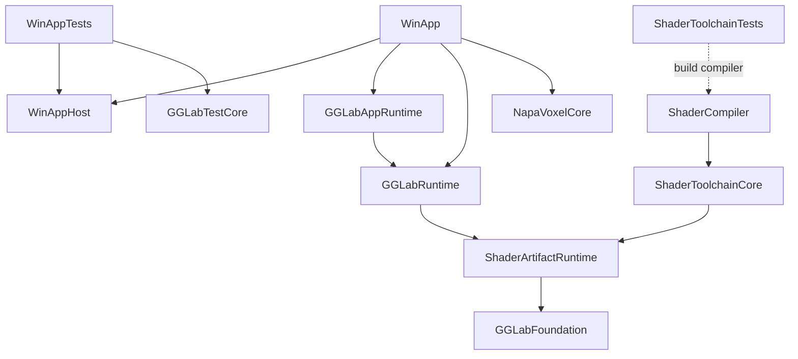

# Repository Ownership and Build Map
Atlas ID: atlas.repository.projects

- Question: which project owns a source file, what does it build against, and
  where may a consumer include its interfaces?
- VerifiedAgainst: `48f6226ef04ad528a744f3ae11933469a64b1627`
- Refresh triggers: solution/project membership, references, imports, include
  visibility or build-profile conditions change.

The [Atlas overview](README.md) follows a frame. This map follows the eighteen
first-party projects in [the solution](../../GraphicsGadgetLab.sln). RenderGraph,
RHI and the native backends are subsystems of `GGLabRuntime`; concrete Labs and
DevTools belong to `WinAppHost`. Instance ownership is described separately in the
[frame and content map](Frame_Execution_Map.md).

## Projects and source ownership

Project links resolve to the authoritative `ClCompile`/`ClInclude` membership.
The source roots below locate those items.

| Project | Source roots | Role |
| --- | --- | --- |
| [WinApp](../../Projects/WinApp/WinApp.vcxproj) | [Sources/WinApp](../../Sources/WinApp) | Native startup, deployment inspection and application bootstrap |
| [WinAppHost](../../Projects/WinAppHost/WinAppHost.vcxproj) | [Sources/WinAppHost](../../Sources/WinAppHost) | Linkable Windows hosts/adapters, concrete Labs and DevTools |
| [WinAppTests](../../Projects/WinAppTests/WinAppTests.vcxproj) | [Tests/WinApp](../../Tests/WinApp) | Host regression cases, runner and real-product integration checks |
| [GGLabAppRuntime](../../Projects/GGLabAppRuntime/GGLabAppRuntime.vcxproj) | [Sources/GGLabAppRuntime](../../Sources/GGLabAppRuntime) | Host-neutral lifecycle, services, frames and content coordination |
| [GGLabRuntime](../../Projects/GGLabRuntime/GGLabRuntime.vcxproj) | [Sources/GGLabRuntime](../../Sources/GGLabRuntime) | Reusable scene, rendering, RenderGraph, RHI and diagnostics library |
| [GGLabFoundation](../../Projects/GGLabFoundation/GGLabFoundation.vcxproj) | [Sources/GGLabFoundation](../../Sources/GGLabFoundation) | Tier-0 facilities |
| [NapaVoxelCore](../../Projects/NapaVoxelCore/NapaVoxelCore.vcxproj) | [Sources/NapaVoxelCore](../../Sources/NapaVoxelCore) | Host-independent voxel library |
| [ShaderArtifactRuntime](../../Projects/ShaderArtifactRuntime/ShaderArtifactRuntime.vcxproj) | [Sources/ShaderArtifactRuntime](../../Sources/ShaderArtifactRuntime) | Shader artifact contracts, identities and consumer support |
| [ShaderToolchainCore](../../Projects/ShaderToolchainCore/ShaderToolchainCore.vcxproj) | [Sources/ShaderToolchain](../../Sources/ShaderToolchain) | Shader compiler, recipe, target and publication implementation |
| [ShaderCompiler](../../Projects/ShaderCompiler/ShaderCompiler.vcxproj) | [Sources/Tools/ShaderCompiler](../../Sources/Tools/ShaderCompiler) | Compiler process and CLI executable |
| [GGLabTestCore](../../Projects/GGLabTestCore/GGLabTestCore.vcxproj) | [Sources/GGLabTestCore](../../Sources/GGLabTestCore) | Shared test/reporting library |
| [GGLabFoundationTests](../../Projects/GGLabFoundationTests/GGLabFoundationTests.vcxproj) | [Tests/GGLabFoundation](../../Tests/GGLabFoundation) | Foundation link and generated Public-header probes |
| [GGLabRuntimeTests](../../Projects/GGLabRuntimeTests/GGLabRuntimeTests.vcxproj) | [Tests/GGLabRuntime](../../Tests/GGLabRuntime) | Runtime contracts and implementation tests |
| [GGLabAppRuntimeTests](../../Projects/GGLabAppRuntimeTests/GGLabAppRuntimeTests.vcxproj) | [Tests/GGLabAppRuntime](../../Tests/GGLabAppRuntime) | Application, capture, parameter and fault-lifecycle tests |
| [NapaVoxelCoreTests](../../Projects/NapaVoxelCoreTests/NapaVoxelCoreTests.vcxproj) | [Tests/NapaVoxelCore](../../Tests/NapaVoxelCore) | Voxel core tests |
| [ShaderToolchainTests](../../Projects/ShaderToolchainTests/ShaderToolchainTests.vcxproj) | [Tests/ShaderToolchain](../../Tests/ShaderToolchain) | Toolchain, publication and compiler-process tests |
| [ShaderRuntimeIntegrationTests](../../Projects/ShaderRuntimeIntegrationTests/ShaderRuntimeIntegrationTests.vcxproj) | [Tests/ShaderRuntimeIntegration](../../Tests/ShaderRuntimeIntegration) | Privileged Shader/Runtime integration tests |
| [GGLabVulkanQualification](../../Projects/GGLabVulkanQualification/GGLabVulkanQualification.vcxproj) | [Sources/GGLabVulkanQualification](../../Sources/GGLabVulkanQualification) | Standalone Vulkan hardware qualification and headless contracts |

`GGLabFoundationHeaderSelfContainment.targets` generates the Foundation probes
inside that test project's intermediate directory. Vendored DirectXTex is a
separate solution project under `Externals/Vender`, outside this first-party set.

`WinAppTests` owns its runner and cases. It links the host library and selects
suites with `--suite`; structural checks launch the actual product's
`--inspect-runtime` entry. Product targets have no test-framework dependency.

## Declared project references

`A → B` means A declares a `ProjectReference` to B. This selected diagram shows
library references with solid arrows and a tool/build-order reference with a
dashed arrow. The table below contains the complete declared reference set.



These declarations cover Debug, Develop and Release on x64. Library-reference
metadata is inherited/omitted except for the explicit values listed after the
table; this is a declared graph, not an MSBuild-evaluated dependency closure.

| Declaring project | Library references | Tool/build-order references |
| --- | --- | --- |
| `WinApp` | `WinAppHost`, `GGLabAppRuntime`, `GGLabFoundation`, `GGLabRuntime`, `NapaVoxelCore`, `ShaderArtifactRuntime` | — |
| `WinAppHost` | `GGLabAppRuntime`, `GGLabFoundation`, `GGLabRuntime`, `NapaVoxelCore`, `ShaderArtifactRuntime` | — |
| `WinAppTests` | `WinAppHost`, `GGLabAppRuntime`, `GGLabFoundation`, `GGLabRuntime`, `GGLabTestCore`, `NapaVoxelCore`, `ShaderArtifactRuntime` | — |
| `GGLabAppRuntime` | `GGLabFoundation`, `GGLabRuntime`, `ShaderArtifactRuntime` | — |
| `GGLabRuntime` | `GGLabFoundation`, `ShaderArtifactRuntime`, `DirectXTex_Desktop_2026` | — |
| `GGLabFoundation` | — | — |
| `NapaVoxelCore` | — | — |
| `ShaderArtifactRuntime` | `GGLabFoundation` | — |
| `ShaderToolchainCore` | `GGLabFoundation`, `ShaderArtifactRuntime` | — |
| `ShaderCompiler` | `ShaderArtifactRuntime`, `ShaderToolchainCore` | — |
| `GGLabTestCore` | — | — |
| `GGLabFoundationTests` | `GGLabFoundation` | — |
| `GGLabRuntimeTests` | `GGLabFoundation`, `GGLabRuntime`, `GGLabTestCore`, `ShaderArtifactRuntime`, `DirectXTex_Desktop_2026` | — |
| `GGLabAppRuntimeTests` | `GGLabAppRuntime`, `GGLabFoundation`, `GGLabRuntime`, `GGLabTestCore`, `ShaderArtifactRuntime` | — |
| `NapaVoxelCoreTests` | `NapaVoxelCore` | — |
| `ShaderToolchainTests` | `GGLabFoundation`, `GGLabTestCore`, `ShaderArtifactRuntime`, `ShaderToolchainCore` | `ShaderCompiler` |
| `ShaderRuntimeIntegrationTests` | `GGLabFoundation`, `GGLabRuntime`, `GGLabTestCore`, `ShaderArtifactRuntime`, `ShaderToolchainCore` | — |
| `GGLabVulkanQualification` | `GGLabFoundation`, `GGLabRuntime`, `GGLabTestCore`; `ShaderArtifactRuntime` [V], `ShaderToolchainCore` [V] | — |

- **[V]:** the reference has condition `'$(GGLAB_ENABLE_VULKAN)'!='0'`.
- **Explicit link metadata:** `LinkLibraryDependencies=true` on WinApp/WinAppTests → Runtime,
  Runtime → DirectXTex, ShaderCompiler → ToolchainCore, and qualification → Runtime
  and ToolchainCore. The last edge retains [V].
- **Host library:** every WinAppHost reference has `LinkLibraryDependencies=false`.
  Its archive contains owned objects; the executables link its library dependencies.
- **Compiler tool:** ToolchainTests → ShaderCompiler has
  `LinkLibraryDependencies=false` and `ReferenceOutputAssembly=false`. The tests
  build the process executable without linking it as a library.
- **DirectXTex configuration:** both referencing projects set
  `Configuration=Release` only when the caller is Develop. The solution maps
  DirectXTex Debug to Debug, and Develop/Release to Release.

## Build profiles and imports

Read conditions with the declaring project and its imports. The relevant profile
changes are:

| Input | Declared effect and evidence |
| --- | --- |
| Debug / Develop / Release, x64 | All eighteen first-party projects declare these configurations. [GGLabBuildBaseline.props](../../PropertySheets/GGLabBuildBaseline.props), directly or through [Common.props](../../PropertySheets/Common.props), supplies the shared build policy. `NapaVoxelCore` keeps its own C++20 build identity |
| `GGLAB_ENABLE_VULKAN` | Defaults to 1 in [VulkanImport.props](../../PropertySheets/VulkanImport.props). `!=0` enables SDK inputs, Runtime/WinAppHost Vulkan sources, the host presentation test and the two [V] references. Qualification's Shader-directory/DXC imports and target also require `!=0` |
| `GGLAB_ARTIFACT_ONLY_RUNTIME` | [WinAppBuildProfile.props](../../PropertySheets/WinAppBuildProfile.props) isolates normal/artifact-only outputs and intermediates for all three Windows host targets. `!=1` includes development Shader startup/process sources and tests; WinApp also retains its conditional Shader/asset deployment imports |
| `GGLAB_USE_PCH` | WinAppHost owns the PCH and disables it for `=0`; both executables use no PCH. The shared host profile separates no-PCH intermediates within each normal/artifact-only profile |
| DXC integration | [DxcImport.props](../../PropertySheets/DxcImport.props) and [DxcImport.targets](../../PropertySheets/DxcImport.targets) are paired early/late imports in ToolchainCore, ShaderCompiler, ToolchainTests, integration tests, AppRuntime tests and qualification; qualification retains [V]. Their package imports preserve `Exists(...)` and package checks. WinApp has no DXC import |

The [asset](../../PropertySheets/LinkAssetDirectory.targets) and
[Shader](../../PropertySheets/LinkShaderDirectory.targets) directory targets also
check Windows and application-project conditions in their bodies. SDK, package
and user imports retain their own conditions in the project files; the table
does not resolve machine-local property values.

## Public consumption and privileged access

The [dependency rules](../../AGENTS.md#ownership-and-dependency-boundaries) own
the permitted direction. Ordinary consumers use the `Public` include roots of
[Runtime](../../Sources/GGLabRuntime/Public),
[Foundation](../../Sources/GGLabFoundation/Public),
[ShaderArtifactRuntime](../../Sources/ShaderArtifactRuntime/Public),
[NapaVoxelCore](../../Sources/NapaVoxelCore/Public) and
[TestCore](../../Sources/GGLabTestCore/Public). AppRuntime exposes its own source
root to the Windows host targets; the Shader tools/tests use `Sources/ShaderToolchain`.

The project include-directory declarations distinguish these cases:

| Consumer | Additional implementation access and purpose |
| --- | --- |
| `WinApp`, `WinAppHost`, `WinAppTests`, `GGLabAppRuntime` | Runtime Public consumption; no Runtime Private include root |
| `GGLabRuntimeTests` | Runtime Private for owning implementation tests |
| `GGLabAppRuntimeTests` | Only Runtime `Private/Graphics/RHI` for the fault harness |
| `ShaderRuntimeIntegrationTests` | Runtime Private and ShaderToolchain for cross-domain numeric/compile tests |
| `GGLabVulkanQualification` | Runtime Private and ShaderToolchain for standalone hardware qualification; conditional Toolchain linkage follows [V] |
| `ShaderToolchainCore`, `ShaderCompiler`, `ShaderToolchainTests` | ShaderToolchain/artifact interfaces, without Runtime/RHI implementation access |
| `GGLabFoundationTests`, `NapaVoxelCoreTests` | The respective library's Public root; Foundation probes use [the generated-header target](../../Projects/GGLabFoundationTests/GGLabFoundationHeaderSelfContainment.targets) |

An include path gives visibility, not source ownership. Runtime implementations
remain compiled by Runtime; the privileged consumers own their test or
qualification sources. Module cards describe the supported
[public rendering seam](Modules/Runtime_Rendering.md#render-host-and-settlement)
and [application interfaces](Modules/Application_Content.md).

## Review and verification

Compare represented membership and references with the project items, including
per-item metadata and conditions, then follow the imports for the changed profile.
Run the [boundary checks](Boundary_And_Drift_Guide.md#checks) for ownership/include
rules and review map freshness separately with the
[local refresh procedure](Boundary_And_Drift_Guide.md#refresh-one-affected-entry).
Executable test commands are in the [CI workflow](../../.github/workflows/build.yml);
scripted suites are listed by
[RunVerification.ps1](../../Tests/Verification/RunVerification.ps1) `-List`.

```text
Anchors:
  - GraphicsGadgetLab.sln
  - Projects/WinApp/WinApp.vcxproj
  - Projects/WinAppHost/WinAppHost.vcxproj
  - Projects/WinAppTests/WinAppTests.vcxproj
  - Projects/GGLabRuntime/GGLabRuntime.vcxproj
  - Projects/ShaderToolchainTests/ShaderToolchainTests.vcxproj
  - Projects/ShaderRuntimeIntegrationTests/ShaderRuntimeIntegrationTests.vcxproj
  - Projects/GGLabVulkanQualification/GGLabVulkanQualification.vcxproj
ReviewPaths:
  - Projects/**/*.vcxproj
  - Projects/**/*.targets
  - PropertySheets/*.props
  - PropertySheets/*.targets
  - AGENTS.md
```
