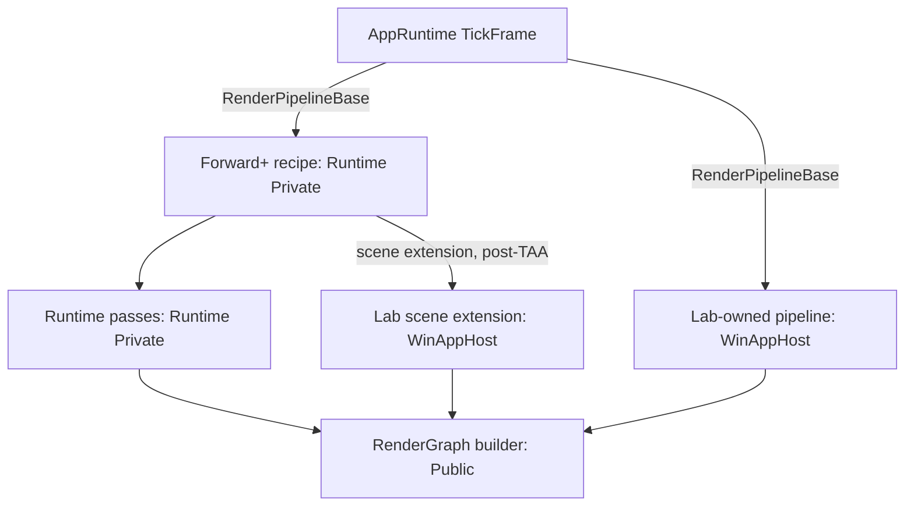

# Runtime Boundaries and Render Pass Composition
Atlas ID: atlas.runtime.composition-boundaries

- VerifiedAgainst: `e8d08f13710eb206ea757292293cd327cebdc510`

Pipelines compose passes into a frame's RenderGraph. The
[frame map](Frame_Execution_Map.md) covers execution and settlement; the
[module catalog](Module_Catalog.md) links interfaces and implementations.

## Composition

Arrows are calls during graph construction; labels name the Public seam.



AppRuntime calls the content's pipeline through `RenderPipelineBase`: it validates
the frame first and builds the graph only for a Ready frame. The pipeline is either
the Runtime Forward+ recipe, created with `CreateRenderPipelineForwardPlus`, or one
a Lab installs with `LabSessionBase::SetRenderPipeline`. Which side owns a new pass
is decided by [Pass ownership](#pass-ownership).

## Runtime-owned passes

A Runtime pass is a stage of a Runtime recipe:

1. Implement it under `Sources/GGLabRuntime/Private/Graphics/RenderPass/`, usually
   deriving `RenderPassBase`.
2. Add it at its position in the recipe's `BuildRenderGraph`. Anything that can make
   the frame unrenderable is classified in `ValidateRenderFrame` first.
3. Declare every graph access through the pass builder and exchange records through
   the blackboard. Records that only Runtime passes use stay Private.
4. Keep prepared pipelines in the pass. History that must commit with the frame goes
   through a settlement participant, as `RenderPassGTAO` does with
   `TemporalFrameTransaction`.
5. Publish frame-dependent CPU state with `DeferCommit`.
6. Use programs as described in [Program consumption](#program-consumption).

`RenderPassForwardPlusCull` shows transient records and a fenced readback;
`RenderPassGTAO` shows temporal history.

The opt-in `RenderPipelineForwardPlusCreateInfo::m_GIReference` configures the
Runtime-owned `RenderPassGIReference` immediately after GI receiver production and
before the temporal boundary. Its Public `GIReferenceCreateInfo` retains a
Lab-prepared, complete `RayScene`; the Runtime recipe imports that scene once and
owns its queries. The initial reference is stateless: it exports scene-referred
irradiance without reading SceneColor or advancing any inter-frame accumulator.

## Lab-owned composition

A Lab composes graph work through two Public seams:

| Route | Position | Example |
| --- | --- | --- |
| Forward+ scene extension, passed as `RenderPipelineForwardPlusCreateInfo::m_SceneExtension` | After the temporal boundary and before transparent shading, writing display color and depth | `NapaVoxelLabSession` → `NapaVoxelRenderExtension` → `NapaVoxelRenderPass` |
| Lab-owned pipeline, a `RenderPipelineBase` installed with `SetRenderPipeline` | The Lab owns the whole graph topology; no Runtime recipe stage runs | `RenderGraphComputeLabSession` |

`RenderPassBase` is optional; the compute Lab declares passes inline. The
post-processing overlay belongs to tooling. Lab work follows the same graph
declaration, retention and commit rules as Runtime passes and registers its programs
with the Lab.

## Program consumption

A pass that uses a new shader program:

1. References it as a `shader_programs` entry in `GGLabShaderPrograms.h`.
2. Adds its build record in `Sources/Tools/ShaderCompiler/GGLabRuntimeShaderBuild.cpp`;
   a new shader source also needs `Scripts/SyncShadersToVS.ps1`.
3. Registers demand: production programs in `GetRendererInitialShaderProgramDemand`,
   Lab programs in its `LabRegistration::m_ShaderPrograms`.
4. Loads it through `RenderServices::m_ShaderPrograms` and resolves pipelines through
   `RenderServices::m_PipelineResolver`.

```text
Anchors:
  - Sources/GGLabRuntime/Public/GGLabRuntime/Graphics/RenderPipeline/RenderPipelineBase.h::RenderPipelineBase
  - Sources/GGLabRuntime/Private/Graphics/RenderPipeline/RenderPipelineForwardPlus.cpp::RenderPipelineForwardPlus::BuildRenderGraph
  - Sources/GGLabRuntime/Public/GGLabRuntime/Graphics/RenderPipeline/RenderPipelineSceneExtensionBase.h::AddOpaqueScenePasses
  - Sources/GGLabAppRuntime/Lab/LabSessionBase.h::SetRenderPipeline
  - Sources/ShaderArtifactRuntime/Public/ShaderArtifactRuntime/GGLabShaderPrograms.h
ReviewPaths:
  - Sources/GGLabRuntime/Private/Graphics/Shader/ShaderProgramCatalog.cpp
  - Sources/Tools/ShaderCompiler/GGLabRuntimeShaderBuild.cpp
  - Sources/GGLabAppRuntime/Lab/LabCatalog.h
  - Sources/GGLabRuntime/Public/GGLabRuntime/Graphics/Pipeline/TemporalAA.h
```

## Contracts
Atlas ID: atlas.runtime.composition-contracts

Pass and resource ownership follow the
[dependency](../../AGENTS.md#ownership-and-dependency-boundaries) and
[RenderGraph](../../AGENTS.md#gpu-shader-and-lab-invariants) rules. Interface contracts are in
[RenderGraph.h](../../Sources/GGLabRuntime/Public/GGLabRuntime/Graphics/RenderGraph/RenderGraph.h)
and the pipeline headers.

### Pass ownership

A pass's owner follows its composition, resources and lifetime:

- It is Runtime-owned when the production recipe requires it or must place it, for
  example before the temporal boundary or between Runtime passes; when it reads or
  publishes a Private record that Runtime passes exchange; or when it requires
  participation in a Runtime-owned settlement transaction, such as temporal history.
- Otherwise it can be Lab-owned and composed through a Public seam, including reuse
  across Labs.
- WinAppHost consumes Runtime Public interfaces. A Lab that needs an internal recipe
  position or Private record requires a Runtime pass, a Public record or a new seam.

### Imported resource ownership

Importing a resource into a RenderGraph does not transfer its ownership, and the code
that imports it need not be its owner. The graph retires only the transients it
creates. The resource's owner keeps it, and any contents the frame reads, valid until
all GPU work that may access it has safely finished: the fence of the last Submitted
frame that used it, and the retention fence of a Failed frame. After
CompletionUnknown the owner follows [Teardown ownership](Frame_Execution_Map.md#teardown-ownership).
The importer declares the initial access and content validity, and the exporting pass
declares the final access.

```text
Anchors:
  - Sources/GGLabRuntime/Public/GGLabRuntime/Graphics/RenderGraph/RenderGraph.h::Retire
  - Sources/GGLabRuntime/Private/Graphics/RenderPipeline/RenderPipelineForwardPlus.cpp::ResolveTemporalFramePlan
ReviewPaths:
  - Sources/GGLabRuntime/Private/Graphics/RenderGraph/RenderGraph.cpp
  - Sources/WinAppHost/Application/Lab/NapaVoxel/NapaVoxelRenderPass.cpp
  - Sources/WinAppHost/Application/Lab/Sessions/NapaVoxelLabSession.cpp
```
