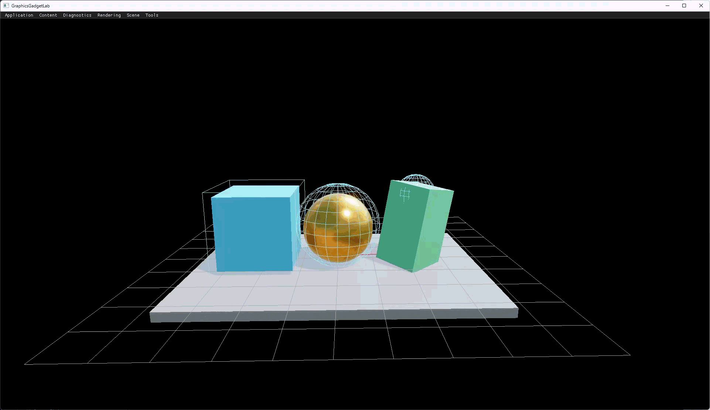

# Graphics Gadget Lab

Graphics Gadget Lab (gglab) is a Windows graphics research playground built with
C++20, Direct3D 12, Vulkan, DXC, and HLSL.

It provides focused graphics Labs for exploring rendering techniques, improving
visual quality, and experimenting with GPU resources, shaders, and diagnostics.

## Highlights

- Runtime-selectable Direct3D 12 and Vulkan backends
- Render graph and reusable render-pass pipelines
- PBR rendering, physical sky lighting, shadows, and post processing
- Focused Labs for graphics experiments
- ImGui-based developer tools, diagnostics, and GPU profiling

## Architecture

The [Architecture Atlas](Docs/Architecture/README.md) explains how the projects are
layered and how a frame is built, submitted and retired, with links into the code
and tests.

## Demo

## Requirements

- Visual Studio 2026
- MSVC toolset v145
- C++20
- Vulkan SDK 1.3.296.0

## Windows host tests

Run `Build/Output/x64/<Configuration>/WinAppTests.exe --suite all` from an unrelated
working directory. Structural suites `app-path-composition` and
`artifact-package-closure` additionally take `--application <absolute-product-exe>`.
Use `--asset-root <absolute-Assets-directory>` when deploying the tests separately.
The product's `--inspect-runtime` prints schema v1 JSON of its effective paths and
selected backend, then exits before creating a window or GPU. Regression suites
are selected by `WinAppTests`, rather than the product's retired `--self-test` flag.
